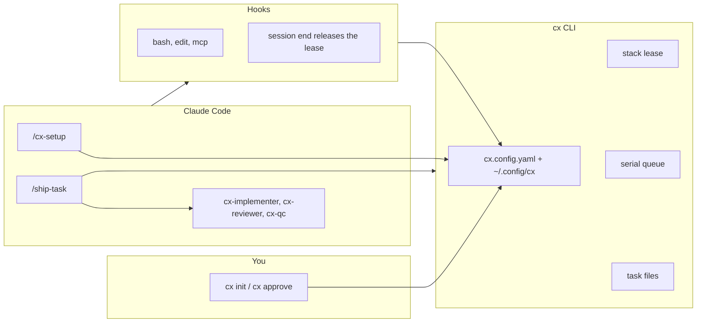

# cx

`cx` is a configurable parallel-feature harness for [Claude Code](https://docs.anthropic.com/en/docs/claude-code). One task can touch several git repos. Each repo gets a worktree (a lane). A small CLI walks a phase list you declare, keeps state in plain files, and stops at human gates.

The first preset, `cluega`, matches one multi-repo workspace: task notes in `plans/`, worktrees in `.worktrees/`, and a single shared Docker stack behind a wrapper script. It is not the only layout. A one-repo project can keep worktrees in `../wt`, store notes in `docs/tasks`, and use no Docker at all.

Ideas are borrowed from the public shipyard snapshot (`minhduc2803/shipyard` at `8dcefcd`). That repository has no license, so none of its code, prompts, or wording is copied here.

## Install

Node.js 20 or newer, plus `git`. Docker is optional and only used when `stack.mode` is not `none`.

```bash
git clone https://github.com/duonghieu7104/cx.git
cd cx
npm ci
npm run build
npm link          # puts cx on your PATH
```

Install the Claude Code skill, slash commands, agents, and hooks into a project or a home directory. Existing files are left untouched.

```bash
cx install --claude-dir .claude          # this project
cx install --scope user                  # ~/.claude
HOME=/tmp/cx-home cx install --scope user   # isolated home, useful in tests
```

Check the setup:

```bash
cx doctor
```

Remove the files cx wrote (it will not delete files you edited):

```bash
cx install --uninstall --claude-dir .claude
```

## Quick start

```bash
cd your-repo
cx init --preset single-repo
cx doctor
cx task new my-feature --title "Short description"
cx ship my-feature --auto-plan
# stops at the human gate
cx approve my-feature commit
cx commit my-feature -m "feat: my feature"
```

In Claude Code, `/cx-setup` writes a config for the repo you have open. `/ship-task my-feature` runs the phases in that config and stops for you before commit, push, or a pull request.

## Bắt đầu nhanh

Cần Node.js 20+ và `git`.

```bash
git clone https://github.com/duonghieu7104/cx.git
cd cx
npm ci
npm run build
npm link
cd du-an-cua-ban
cx init --preset single-repo
cx doctor
cx task new tinh-nang --title "Mô tả ngắn"
cx ship tinh-nang --auto-plan
```

Lệnh dừng ở cổng người duyệt. Trong terminal của bạn (không phải trong Claude):

```bash
cx approve tinh-nang commit
cx commit tinh-nang -m "feat: tinh nang"
```

Trong Claude Code:

- `/cx-setup` xem repo, hỏi những gì không suy ra được, rồi ghi `cx.config.yaml`.
- `/ship-task tinh-nang` chạy các phase trong config và dừng trước khi commit, push, hoặc mở PR.

Preset `cluega` dành cho workspace nhiều repo, thư mục `plans/`, worktree trong `.worktrees/`, và một stack Docker dùng chung. Xem phần Presets. Những biến tag chưa xác nhận ghi là `REPLACE_ME_*`. Lệnh check chưa biết để trống; `cx check` sẽ báo, không tự đoán.

## Architecture



The CLI is the only thing that should change a shared stack. Hooks load `cx.config.yaml` by walking up from the tool call's `cwd`. They do not need variables exported by the parent process. `~/.config/cx/config.yaml` can override personal preferences such as cooldown and notifications. Guard lists are additive: a user file can add a block, and it cannot delete one the project set.

State is a YAML block inside the task file you configure (often `README.md`), between `<!-- cx:state:begin -->` and `<!-- cx:state:end -->`. Writes are atomic. The lock is a `mkdir`, which works on macOS and Linux (`flock` is not required).

## Config

Project file, first match walking up from the working directory:

- `cx.config.yaml` or `cx.config.yml`
- `cx.config.json`
- `.cx/config.yaml` or `.cx/config.json`

User overlay, used when `HOME` is set:

- `~/.config/cx/config.yaml`

`cx config validate` prints a file path and a line when it can. `cx config schema` prints a short JSON Schema. `cx config print --json` prints the merged config.

| Key | What it controls |
|---|---|
| `workspace.mode` | `single-repo` or `multi-repo` |
| `workspace.root` | Workspace root, relative to the config file |
| `workspace.repos[]` | `id`, `alias`, `path`, `base`, optional `checkout`, `check`, `build`, `test`, `services`, `images` |
| `worktree.root` | Worktree directory. Relative paths such as `../wt` and absolute paths are both fine |
| `worktree.pattern` | `{task}`, `{repo}`, `{alias}` |
| `worktree.branch_pattern` | `{type}`, `{desc}`, `{task}`, `{repo}`, `{alias}` |
| `tasks.root` | Task records. `none` stores them under `.cx/tasks` |
| `tasks.folders` | Phase id to folder name |
| `phases[]` | `id`, `enabled`, `actor` (`human`, `agent`, `cli`), `skill`, `subagent`, `prompt`, `gate`, `command`, `max_rounds` |
| `stack.mode` | `none`, `per-lane`, or `shared` |
| `stack.wrapper` | Command used for a shared stack. cx always passes `--no-deps` and exports every baseline tag variable |
| `stack.services[]` | `name`, `tag_var`, `image`, `kind` (`image` or `mount`) |
| `queue` | `serial` or `parallel`, `cooldown` (`60s`, `45m`), directory |
| `gates.require` | Actions that need `cx approve` (`plan`, `commit`, `push`, `pr`, or your own slug) |
| `gates.bind_to_head` | An approval dies when HEAD or the worktree diff changes |
| `guards` | Blocked command regexes, protected-file globs, MCP deny globs, secret-assignment regexes |
| `notifications.on_gate` | `stdout`, `none`, `osascript`, or `command` |
| `claude` | Preferred install scope (`project` or `user`) and config directory, recorded for humans and for `/cx-setup` |
| `doctor.env_files` | Paths whose mode is checked. Contents are never read |

`phases[].prompt` may be `builtin:proposal`, `builtin:plan`, `builtin:execute`, `builtin:review`, or `builtin:test-local`. A relative path uses your own prompt file instead.

`cx approve` is always refused when `CLAUDECODE`, `CLAUDE_CODE`, or `CX_ACTOR=agent` is set, and the bash hook always denies the command. That rule is not configurable.

## Presets

`cx init --preset <name>` writes `cx.config.yaml`. It will not overwrite an existing file unless you pass `--force`. It also creates `~/.config/cx/` at mode `700` and an example overlay, and appends worktree and state directories to `.gitignore` if they are missing.

| Preset | Layout |
|---|---|
| `single-repo` | One repo at `.`, worktrees in `.worktrees`, notes in `docs/tasks`, no Docker, check command `true` until init sees a real test script. Plan review is a human gate. Local browser testing is off. |
| `multi-repo` | Example `services/api` and `apps/web` repos, same phase list, no Docker. Edit the paths. |
| `cluega` | Repos named as in that workspace, base `dev` except the extension and desktop runtime (`main`). Notes in `plans/<task>/`. Worktrees `.worktrees/{task}-{repo}`. Branch `{type}/{desc}`. Shared project `cluega-local` through `.local-stack/batchlaunch-dc.sh`. Known tag variables are `BATCH_CDP_TAG`, `BATCH_RAKAZO_TAG`, `BATCH_GATEWAY_TAG`, and `BATCH_FE_APP`. Unconfirmed ones are `REPLACE_ME_*`. Empty `check` means "do not guess". |

`cx init --from-inspect` writes a draft from the current tree and lists the questions it could not answer as comments.

Lines marked `# cx-init:base` and `# cx-init:check` are rewritten from the git branch and the detected test command.

## `/cx-setup`

The skill `cx-setup` is generic. It does not know about any one workspace.

1. Run `cx inspect` and read the JSON: git layout, sibling and child repos, package manager, scripts, Makefile targets, compose files, task folders, worktree folders, and whether Superpowers, Graphify, GitNexus, or claude-mem appear under `.claude`.
2. Explain what it inferred.
3. Ask only the `questions` array, plus anything still ambiguous (worktree location, shared stack versus per-lane versus none, which branch is the base, which gates you want).
4. Run `cx init --preset single-repo`, `--preset multi-repo`, or `--from-inspect`, then edit.
5. Point phases at Superpowers skills when those skills are installed, otherwise at the built-in prompts.
6. Run `cx config validate` and `cx doctor`.

The slash command is `/cx-setup`. `/ship-task <task>` reads the same phase list. It uses `cx-implementer`, `cx-reviewer`, and `cx-qc` for the execute, review, and local-test phases. It stops at the first human phase and does not run `cx approve`.

`cx ship <task> [--auto-plan] [--until <phase>]` is the CLI version of that walk. `--auto-plan` records an automatic plan approval and continues. The final gate still waits.

## Commands

```text
cx init --preset single-repo|multi-repo|cluega
cx init --from-inspect
cx config validate|print|schema
cx inspect
cx doctor
cx task new <task> --title "..." [--repos a,b] [--type feat] [--desc kebab]
cx task list
cx task status [task] [--json]
cx task park|resume <task>
cx lane add|rm <task> <repo> [--force]
cx stack status|lease|swap|release|recover|up|down|baseline
cx build <task> <service>
cx queue
cx check <task> [repo]
cx test-local <task>
cx approve <task> <what>
cx approve status <task>
cx commit <task> -m "message"
cx pr <task> [--submit]
cx ship <task> [--auto-plan]
cx phase prompt <task>
cx install [--claude-dir DIR]
cx dash [--port 8377]
```

Shared stack:

- `cx stack lease <task>` creates the lease with `mkdir`, snapshots `docker compose ps`, and prints `CX_LEASE_TOKEN` once. Only the hash is stored.
- `cx stack swap` checks the token, exports every baseline tag variable, and calls the wrapper with `up -d --no-deps`.
- `cx stack release` restores swapped services in reverse order and checks the snapshot. A mismatch keeps the lease and marks the task `blocked`.
- `cx stack recover --yes` restores an orphan (heartbeat older than the TTL and the pid is gone). It will not steal a live lease. Without `--yes` it prints the plan and exits.

Per-lane mode runs `docker compose -p cx-<task> up -d` and `down` without `-v`.

`cx check` and `cx build` take a ticket on the serial queue and wait for `queue.cooldown`.

`cx test-local` writes a report and does not read `.env` files. A browser runner is not in this release, so the target app does not need a Playwright dependency.

`cx commit` needs a fresh `commit` approval. It leaves `*.md`, `SKILL.md`, `.claude/`, `.agents/`, and `.gitnexus/` unstaged, and it refuses protected files. `cx pr --submit` needs fresh `push` and `pr` approvals, then pushes and runs `gh`.

## Comparison with shipyard

Measured on the public snapshot `8dcefcd` (17 Nov 2026), not on this repo.

| | cx | shipyard snapshot |
|---|---|---|
| License | MIT | none |
| Runtime dependencies | `yaml` only | dashboard `npm install` pulled 166 packages (~53 MB) |
| Control-plane RAM | the CLI exits; no dashboard process | dashboard about 69–74 MB |
| A lane | git worktree, plus your existing stack if you opt in | full app clone with its own Postgres and Redis, about 340–390 MB for a small demo |
| Config | one declarative file per project, optional user overlay | a profile of shell and env files |
| Hooks | read the project config from `cwd`; covered by an `env -i` test | hook subprocesses did not receive `profile.env` |
| Browser checks | not bundled here; the target repo is not required to depend on `@playwright/test` | QA login imported `@playwright/test` from the target frontend |
| Secrets | never written into agent files or API responses; doctor only `stat`s env files; logs run through a redactor | seed and QA passwords were written into mode `644` agent files, `GET /api/lane/:n/creds-current` returned them without auth, and lane env helpers printed them |

## Dashboard

`cx dash` serves a read-only board on `127.0.0.1` (port 8377 unless you pass `--port`). The process prints a one-time `?t=` link. That token is stored in `~/.config/cx/dash.token` at mode `600` and then kept in an `HttpOnly; SameSite=Strict` cookie. Requests with the wrong `Host` header are rejected. There is no route for credentials, and `cx approve` is not a button.

The views are the phase board, a task page (pipeline, lanes, check output, proof lightbox, gate status), the shared-stack lease with baseline versus current tags, and the build queue.

Screenshots below are from a tiny Node app named pulse. `cx init --preset single-repo` and `cx task new` / `cx lane` created a real branch `feat/healthz` and worktree `.worktrees/healthz-app`. A stub stood in for the Claude CLI and wrote `/health` plus its test (labeled in the captions). `cx check` then ran that app's real `npm test`. A second task, `readme-pass`, is a second real worktree. The stack and queue shots use the `cluega` preset and a fake wrapper.

| Shot | What it shows |
|---|---|
| [01-empty-board.png](docs/screenshots/01-empty-board.png) | Board before any task. |
| [02-task-created.png](docs/screenshots/02-task-created.png) | `healthz` on the board at intake, with its lane. |
| [03-lane-worktree.png](docs/screenshots/03-lane-worktree.png) | Branch `feat/healthz` and worktree `.worktrees/healthz-app`. |
| [04-implement.png](docs/screenshots/04-implement.png) | Execute phase while the stub is writing `/health`. Stubbed agent. |
| [05-checks-passed.png](docs/screenshots/05-checks-passed.png) | Real `npm test`: `GET /health says ok`, status `checks-green`. |
| [06-review-go.png](docs/screenshots/06-review-go.png) | Review verdict GO. The reviewer text is from the stub. |
| [07-qc-proof.png](docs/screenshots/07-qc-proof.png) | Proof lightbox. The image is a real browser shot of the sample `/health` page. |
| [08-human-gate.png](docs/screenshots/08-human-gate.png) | Task sitting in the gate column. |
| [09-approved.png](docs/screenshots/09-approved.png) | After `cx approve healthz commit` in a normal terminal. |
| [10-two-tasks.png](docs/screenshots/10-two-tasks.png) | `readme-pass` at intake beside `healthz` at the gate. Two real worktrees. |
| [11-stack-lease.png](docs/screenshots/11-stack-lease.png) | Cluega preset, fake wrapper. Lease held by `streamfix`, cdp drifted to `cx-streamfix-demo`. |
| [12-build-queue.png](docs/screenshots/12-build-queue.png) | That same workspace with a check ticket running. |

`git worktree list` from the sample is in [terminal-worktree.txt](docs/screenshots/terminal-worktree.txt). The check command's output is in [terminal-checks.txt](docs/screenshots/terminal-checks.txt).

## Development

```bash
npm ci
npm test
```

`npm test` compiles TypeScript and runs the Node test runner: config validation, the state machine, the mkdir lock, the serial queue, lease and restore against a fake `docker` and wrapper, guard hooks under `env -i`, approvals bound to HEAD, the installer, a stubbed `/ship-task` on a sample repo, the `cluega` preset on a fake multi-repo tree, and the dashboard API (auth, host check, read-only, no credential route, proof path checks).

GitHub Actions runs the same command on Node 20 and Node 22.

## Later milestones

- **M4.** `cx pr` already submits when you ask. Still open: a read-only PR watcher, and a `detect-changes` step for repos that have one.
- **M5.** Done. `cx dash` is the read-only board in the Dashboard section.
- **M6.** Notification commands beyond stdout and `osascript`, a thermal pause in the build queue, and a real browser runner that lives in this repo rather than in the target app.

## License

MIT. See [LICENSE](LICENSE).
